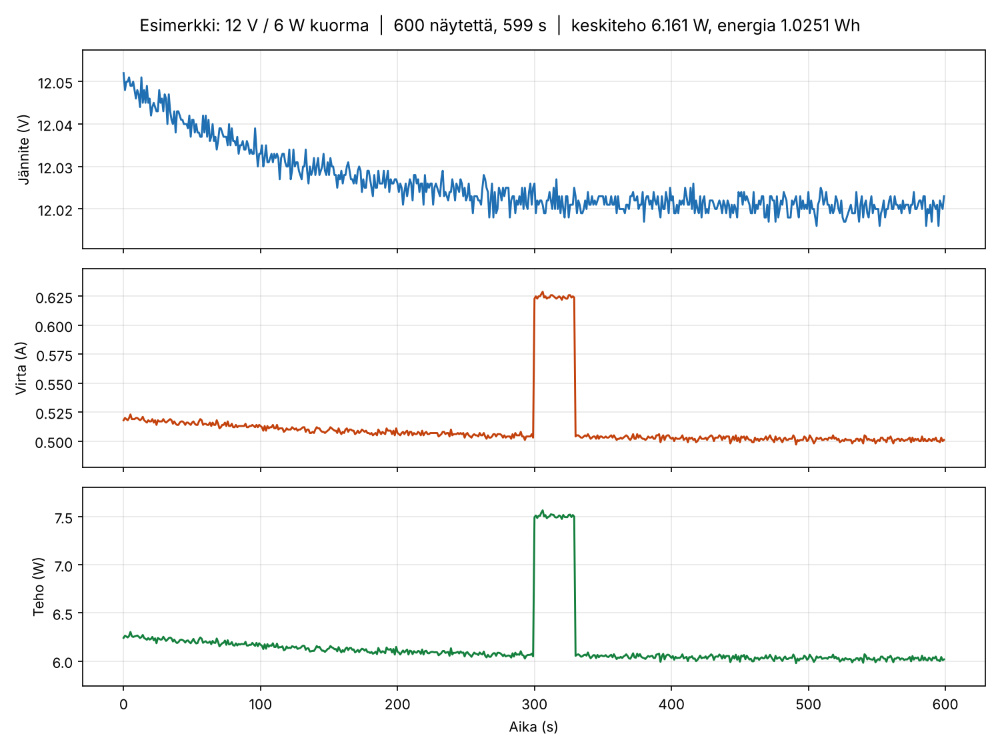
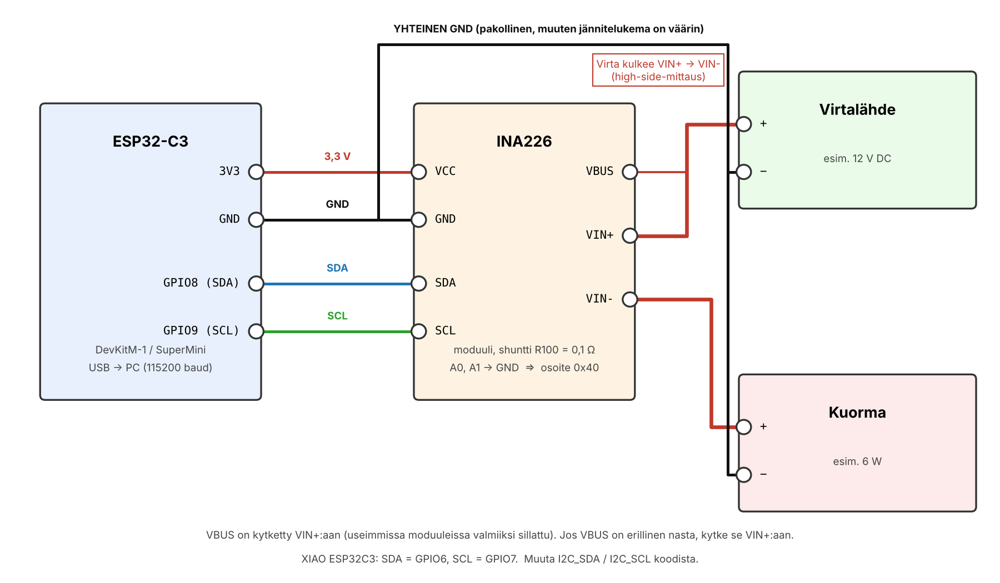

# INA226 Power Logger (ESP32-C3)

Yksinkertainen tehomittari ja loggeri: ESP32-C3 lukee INA226-sensorilta jännitteen, virran ja tehon kerran sekunnissa ja tulostaa ne sarjaporttiin CSV-muodossa. Oletuksena 10 minuutin loki (600 näytettä), joka aukeaa suoraan suomalaiseen Exceliin.

*[English summary](README.en.md)*



## Ominaisuudet

- Jännite (V), virta (A) ja teho (W) sekunnin välein, 3 desimaalin tarkkuudella
- Laitteistotason keskiarvoistus (256 näytettä) – siisti käyrä ilman kohinaa
- CSV suomalaiselle Excelille: puolipiste-erotin ja desimaalipilkku (vaihdettavissa)
- Kiinteä aikataulutus `millis()`-pohjaisesti – aika-akseli ei liu'u
- Selkeät virheilmoitukset, jos sensoria ei löydy tai kalibrointi epäonnistuu
- Python-skriptit lokin tallennukseen ja kuvaajan piirtämiseen

## Tarvittavat osat

| Osa | Huomio |
|---|---|
| ESP32-C3 -kehityslevy | DevKitM-1, SuperMini, XIAO ESP32C3 tms. |
| INA226-moduuli | Yleisin on "R100"-moduuli (0,1 Ω shuntti), maksimivirta 0,8 A |
| Virtalähde ja kuorma | Esim. 12 V DC ja 6 W kuorma (0,5 A) |
| Johtimia | 4 kpl I2C/käyttöjännite, 3 kpl mittauspiiri |

> **Huomaa shuntin raja.** INA226 mittaa shunttijännitettä vain ±81,92 mV. R100-moduulilla (0,1 Ω) suurin mitattava virta on siis **0,8 A** riippumatta siitä, mitä koodiin kirjoittaa. 6 W kuorma 12 V:lla on 0,5 A (ok), mutta 5 V:lla 1,2 A (ei ok) – silloin tarvitset R010-moduulin tai vaihdat shunttivastuksen.

## Kytkentä



| ESP32-C3 | INA226 |
|---|---|
| 3V3 | VCC |
| GND | GND |
| GPIO8 | SDA |
| GPIO9 | SCL |

Mittauspiiri (high-side):

```
Virtalähde (+)  ──►  VIN+  ═ shuntti ═  VIN-  ──►  Kuorma (+)
Virtalähde (−)  ─────────────────────────────────  Kuorma (−)  ──►  INA226 GND
```

Tärkeää:

- **Yhteinen maa on pakollinen.** Virtalähteen miinus on kytkettävä INA226:n (ja ESP32:n) GND:hen, muuten jännitelukema on väärin tai nolla.
- **VBUS** mittaa väyläjännitteen. Useimmissa moduuleissa se on sillattu valmiiksi VIN+:aan; jos moduulissasi on erillinen VBUS-nasta, kytke se VIN+:aan.
- **A0 ja A1** GND:ssä → I2C-osoite 0x40 (moduulin oletus).
- **XIAO ESP32C3**: SDA = GPIO6, SCL = GPIO7. Muuta `I2C_SDA`/`I2C_SCL` koodin alusta.
- Jos virta näkyy negatiivisena, VIN+ ja VIN- ovat väärinpäin.

## Asennus

### Arduino IDE

1. Asenna ESP32-levytuki: *File → Preferences → Additional boards manager URLs*:
   `https://raw.githubusercontent.com/espressif/arduino-esp32/gh-pages/package_esp32_index.json`
   ja sitten *Boards Manager → esp32 by Espressif Systems*.
2. Asenna kirjasto *Library Manager* → hae **INA226** → **INA226 by Rob Tillaart** (versio 0.6.0 tai uudempi).
3. Avaa `ina226_logger/ina226_logger.ino`.
4. Valitse levy (esim. *ESP32C3 Dev Module*) ja portti. SuperMini-levyillä laita *USB CDC On Boot: Enabled*, muuten sarjamonitoriin ei tule mitään.
5. Tarkista asetukset koodin alusta (shuntti, pinnit, CSV-muoto) ja lataa.

### PlatformIO

```
pio run -e devkitm -t upload      # ESP32-C3-DevKitM-1
pio run -e supermini -t upload    # SuperMini ja muut natiivi-USB-levyt
pio run -e xiao -t upload         # Seeed XIAO ESP32C3
pio device monitor
```

`platformio.ini` on mukana ja hakee kirjaston automaattisesti.

## Asetukset

Kaikki muokattavat arvot ovat `ina226_logger.ino`-tiedoston alussa:

| Vakio | Oletus | Selitys |
|---|---|---|
| `I2C_SDA`, `I2C_SCL` | 8, 9 | I2C-pinnit |
| `INA_ADDRESS` | 0x40 | I2C-osoite (A0/A1-nastojen mukaan 0x40–0x4F) |
| `SHUNT_OHM` | 0.100 | Shunttivastus ohmeina (R100 = 0,1; R010 = 0,01) |
| `MAX_CURRENT_A` | 0.75 | Suurin mitattava virta. `MAX_CURRENT_A × SHUNT_OHM` on oltava alle 0,080 V |
| `MAX_SAMPLES` | 600 | Näytteiden määrä |
| `INTERVAL_MS` | 1000 | Näyteväli millisekunteina |
| `AVERAGING` | `INA226_256_SAMPLES` | Laitteiston keskiarvoistus (1…1024 näytettä) |
| `CSV_SEPARATOR` | `;` | Sarake-erotin |
| `DECIMAL_POINT` | `,` | Desimaalimerkki |

Shunttiarvot ja virtarajat:

| Moduulin merkintä | Vastus | Max virta | `MAX_CURRENT_A` |
|---|---|---|---|
| R100 | 0,100 Ω | 0,8 A | 0.75 |
| R050 | 0,050 Ω | 1,6 A | 1.5 |
| R010 | 0,010 Ω | 8 A | 7.5 |
| R002 | 0,002 Ω | 40 A | 38 |

## Lokin tallennus

Sarjaporttiin tulee ensin otsikkorivi, sitten datarivit ja lopuksi `Valmis`:

```
Aika(s);Jannite(V);Virta(A);Teho(W)
0,0;12,051;0,521;6,278
1,0;12,049;0,520;6,266
...
599,0;12,021;0,502;6,034
Valmis
```

Tallennusvaihtoehdot:

- **Python** (suositus, suodattaa boottilokin pois automaattisesti):
  ```
  pip install pyserial
  python tools/serial_logger.py COM5            # Windows
  python tools/serial_logger.py /dev/ttyUSB0    # Linux
  ```
  Skripti lopettaa itsestään, kun laite tulostaa `Valmis`.
- **PuTTY**: *Session → Logging → All session output*, baud 115200.
- **PlatformIO**: `pio device monitor > loki.csv`
- **Arduino IDE:n sarjamonitori**: kopioi teksti ja liitä tiedostoon. Poista ylimääräiset rivit alusta.

### Avaaminen Excelissä

Suomalainen Excel avaa tiedoston suoraan tuplaklikkaamalla (`;`-erotin, desimaalipilkku). Jos käytät englanninkielistä Exceliä tai Google Sheetsiä, vaihda koodista `CSV_SEPARATOR = ','` ja `DECIMAL_POINT = '.'`.

Otsikkorivi on tarkoituksella ilman ääkkösiä (`Jannite`), jotta se näkyy oikein riippumatta siitä, millä merkistöllä tallennusohjelma kirjoittaa tiedoston.

### Kuvaajan piirtäminen

```
pip install pandas matplotlib
python tools/plot_log.py loki.csv                  # näyttää ikkunassa
python tools/plot_log.py loki.csv -o kuvaaja.png   # tallentaa tiedostoon
```

Skripti laskee myös keskitehon ja kulutetun energian (Wh). Esimerkkiloki on tiedostossa `examples/example_log.csv`.

## Vianetsintä

| Ilmoitus / oire | Syy ja korjaus |
|---|---|
| `VIRHE: INA226 ei vastaa` | Tarkista SDA/SCL (ja että ne eivät ole ristissä), VCC = 3,3 V, GND, A0/A1-osoite. Aja tarvittaessa I2C-skanneri. |
| `kalibrointi epäonnistui, koodi 0x8000` | `MAX_CURRENT_A × SHUNT_OHM` ylittää 0,080 V. Pienennä virtaa tai käytä pienempää shunttia. |
| `koodi 0x8001` | `MAX_CURRENT_A` alle 0,001 A. |
| `koodi 0x8002` | `SHUNT_OHM` alle 0,001 Ω. |
| Jännite 0 V tai outo | Yhteinen maa puuttuu tai VBUS ei ole kytketty VIN+:aan. |
| Virta 0 A, jännite ok | Kuorma ei ole kytketty VIN-:n kautta (virta ei kulje shuntin läpi). |
| Virta negatiivinen | VIN+ ja VIN- väärinpäin. |
| Virta jumittuu ~0,8 A:iin | Shuntin mittausalue täynnä – pienempi shuntti. |
| Sarjamonitori tyhjä (SuperMini) | *USB CDC On Boot: Enabled* levyasetuksista. |
| `Task watchdog got triggered` | Ei pitäisi esiintyä tällä koodilla; jos muokkaat, älä käytä `while(1);` ilman `delay()`. |

## Hakemistorakenne

```
ina226-power-logger/
├── ina226_logger/
│   └── ina226_logger.ino     Arduino-sketsi
├── tools/
│   ├── serial_logger.py      Lokin tallennus sarjaportista
│   └── plot_log.py           Kuvaajan piirto CSV:stä
├── examples/
│   └── example_log.csv       Esimerkkiloki (10 min, 12 V / 6 W)
├── docs/
│   ├── wiring.png / .svg     Kytkentäkaavio
│   └── example_plot.png      Esimerkkikuvaaja
├── platformio.ini
├── LICENSE
└── README.md
```

## Toteutuksen huomiot

Nämä ovat yleisiä sudenkuoppia Rob Tillaartin INA226-kirjaston kanssa, jotka tämä koodi välttää:

- `setMaxCurrentShunt()` palauttaa virhekoodin eikä kirjoita kalibrointia, jos `maxCurrent × shunt > 0,080 V`. Ilman kalibrointia virta ja teho ovat nollaa. Koodi tarkistaa paluuarvon.
- `setAverage()` ottaa rekisteriarvon 0–7 (`INA226_256_SAMPLES` = 5), ei näytteiden määrää. `setAverage(256)` ei tee mitään.
- 256 näytteen keskiarvo oletuskonversioajoilla (1,1 ms + 1,1 ms) kestää noin 0,56 s. Jos nostat keskiarvoistuksen 1024:ään (~2,25 s), nosta myös `INTERVAL_MS` vähintään 2500:aan, muuten luet saman arvon kahdesti.
- ESP32-C3 on yksiytiminen: `while(1);` ilman `delay()`-kutsua nälkiinnyttää idle-taskin ja task watchdog alkaa tulostaa varoituksia.

## Lisenssi

MIT – katso [LICENSE](LICENSE).
